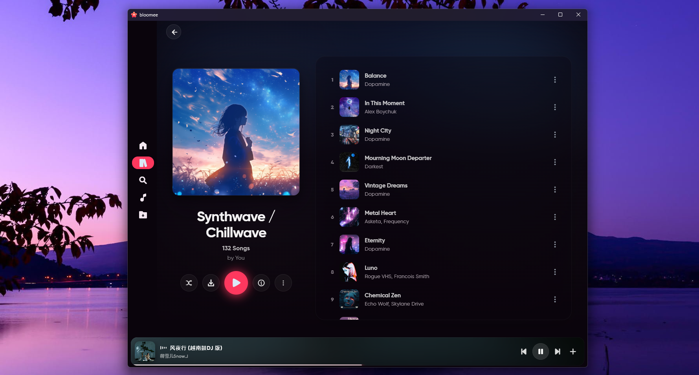
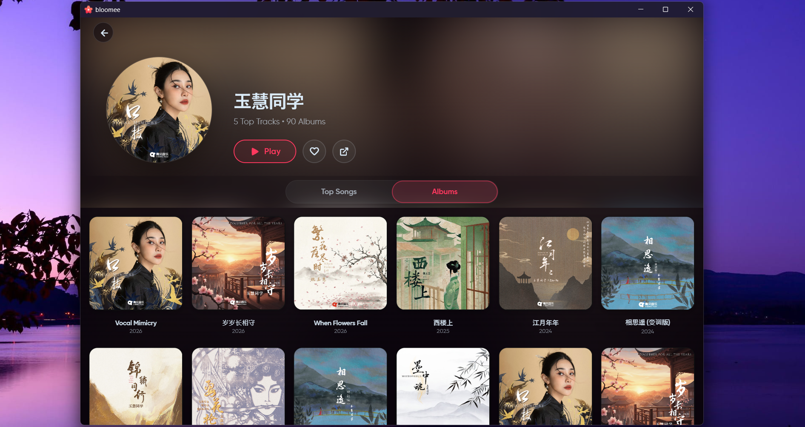
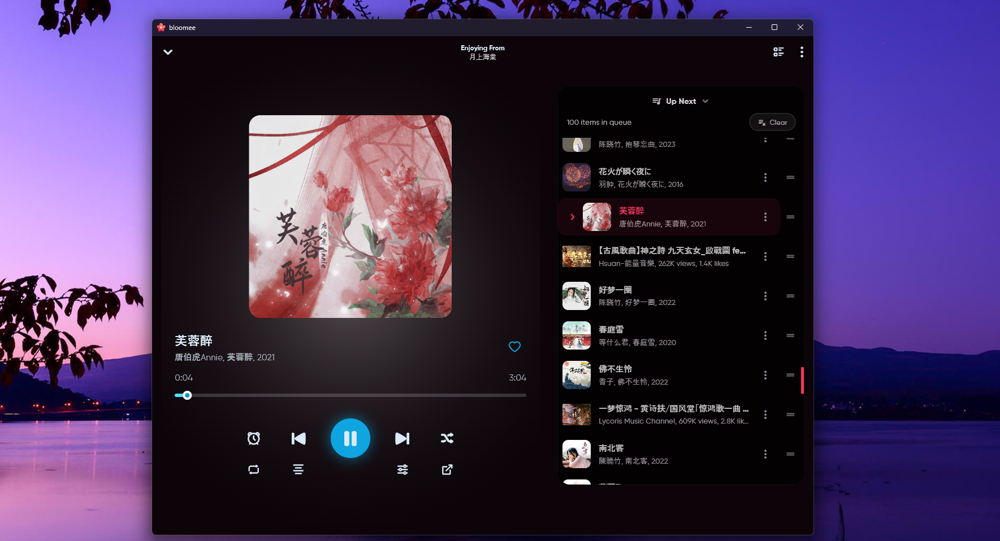
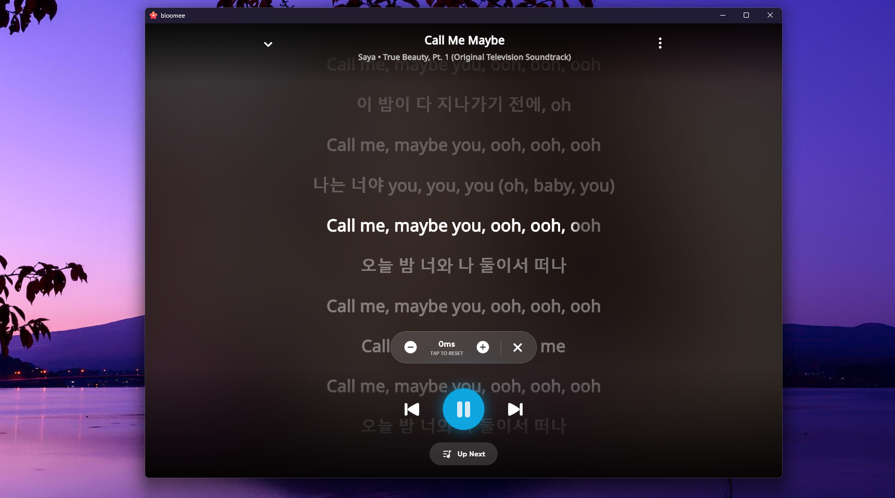
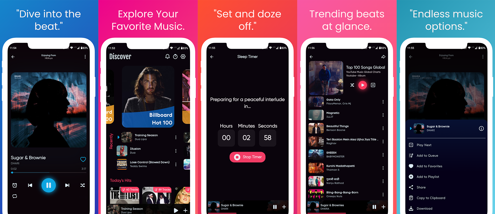

<div align="center">

# Orvia 

**A unified local and plugin-first streaming music player built with Flutter & Rust.**

<p align="center">
  
  <a href="https://github.com/Ankitcodes30/Orvia/releases/latest">
    
    
  </a>
  
  
  <br>
  
  
  
</p>

<a href="https://trendshift.io/repositories/11533" target="_blank"></a>

**Orvia** is an experimental, open-source music player designed to give you absolute freedom over your audio. Seamlessly mix your **local device music** with an infinite universe of streams powered by a secure, **Rust-backed plugin system**. No ads, no interruptions—just your tunes, your way. 🌼🎵

</div>

<div align="center">
  <p float="left">
    
    
  </p>
  <p float="left">
    
    
    
  </p>
</div>

---

> ⚠️ **SECURITY WARNING: BEWARE OF FAKE WEBSITES!** ⚠️    
> Several unofficial websites claim to be the "official" Orvia site. The ONLY official website maintained by me is:
> 
> 🌐 **https://ankitcodes30.github.io/Orvia/**
>
> This is the only official and safe website for Orvia. Do not trust other websites claiming to be official — unofficial sites may distribute modified APKs or malware. I am **not responsible** for any damage, privacy loss, or issues caused by downloading the app from third-party sources.

---

## 🚀 Features

- 🚫 **Ad-Free Experience:** Zero ads, zero tracking, zero interruptions.
- 🦀 **Plugin System:** Secure, auto-updating `.bex` plugin system for endless music sources powered by Rust.
- 📂 **Local Music & Collections:** Play your local offline audio seamlessly alongside online streams, organized into offline collections.
- 🎨 **Dynamic Home Carousel & Time-Aware Banners:** Smart scheduling rotates tailored collections:
  - 🌅 **Morning Bhakti:** 26 verified sacred chants, Hanuman Chalisa, and morning devotional hymns (active 6:00 AM – 10:30 AM).
  - 🪔 **Diwali Festive Special:** Verified one-time 2026 festive experience featuring 19 curated Ram Bhajans and Lakshmi Puja hymns.
  - ⚡ **Gym Energy:** High-BPM workout motivation and cardio hits.
- 🔒 **Protected System Playlists:** **Creator's Choice** features 70 carefully curated melodies (38 classic selections + 32 exclusive YouTube tracks) safeguarded with database-level immutability against deletion, renaming, or modification.
- 🎤 **Karaoke-Style Lyrics:** Time-synced lyrics with manual offset adjustment.
- 🎛️ **Audio Equalizer:** Built-in equalizer and customizable crossfade transitions.
- 🔄 **Smart Replace:** Auto-recovery finds working streams if a playlist track becomes unavailable.
- 📊 **Last.fm Scrobbling:** Optional listening history logging with offline caching.
- 🎮 **Discord Rich Presence:** Show your currently playing tracks on Discord.
- 🌍 **Global Charts:** Discover trending charts from installed plugins.
- 🖥️ **Cross-Platform:** Native media controls, hotkeys, and system integrations for Windows, Android, and Linux.
- 💾 **Backup & Restore:** Easily export/import your library and settings via JSON or M3U.
- 🤖 **Smart Recommendations:** Context-aware suggestions based on your listening flow.
- 🆎 **Multi-Language Support:** Fully localized app interface.

---

## 🌍 Language Support

| Language | Native Name | Status |
|---|---|---|
| 🇮🇳 Hindi | हिन्दी | ✅ Complete |
| 🇺🇸 English | English | ✅ Complete |
| 🇰🇷 Korean | 한국어 | ✅ Complete |
| 🇩🇪 German | Deutsch | ✅ Complete |
| 🇪🇸 Spanish | Español | ✅ Complete |
| 🇯🇵 Japanese | 日本語 | ✅ Complete |

---

## 📥 Download & Installation

The latest official release is **v3.0.7** (Build `7`).

<p align="center">
  <a href="https://ankitcodes30.github.io/Orvia/">
    
  </a>
  &nbsp;
  <a href="https://github.com/Ankitcodes30/Orvia/releases">
    
  </a>
  &nbsp;
  <a href="https://sourceforge.net/projects/orvia/files/latest/download">
    
  </a>
</p>

### 📱 Android
1. Download the official APK directly from the [Orvia Website](https://ankitcodes30.github.io/Orvia/) (`app-release.apk`).
2. If prompted by Android, allow installation from your browser ("Install unknown apps").
3. Verify that the app is signed with the official certificate (`CN=Ankit Kumbhare, O=Orvia`).

### 💻 Windows
1. Download `Orvia-Windows.zip` from the [Orvia Website](https://ankitcodes30.github.io/Orvia/).
2. Extract the ZIP archive completely to a folder of your choice.
3. Launch `orvia.exe` to start the player. No installer required (portable).

### 🐧 Linux (Development)
Builds and packages are available via GitHub Releases and SourceForge mirrors.

---

## 🧪 Automated Testing & Quality Assurance

Orvia maintains a rigorous test suite covering UI components, database operations, background playback, and edge cases:

- **Total Test Cases:** 537 automated unit and integration tests passing.
- **Coverage Areas:**
  - Creator's Choice immutability and DAO protection.
  - Indian festival scheduling windows and timezone conversions.
  - Multi-select context behavior and tab transitions.
  - Database schema migrations and cross-provider track reconciliation.
  - Windows update resilience and release manifest parsing.

To run the complete automated suite:
```bash
flutter test -j 4
```

---

## 🛠️ Building from Source

### Prerequisites
- **Flutter SDK:** `3.35.4+` (CI tested on `3.35.4`, release build verified on Flutter `3.47.5` stable, Dart `>=3.3.0 <4.0.0`)
- **Rust Toolchain:** `stable` with `cargo` (required for plugin bridge)
- **Java Development Kit (JDK):** Version 17 (for Android build)
- **Gradle:** `8.14+` (managed via included Gradle Wrapper)
- **Android SDK:** Platform tools and Build Tools (API 35+)
- **Visual Studio Build Tools:** C++ Desktop development workload (for Windows build)

### Build Instructions

1. **Clone the repository:**
   ```bash
   git clone https://github.com/Ankitcodes30/Orvia.git
   cd Orvia
   ```

2. **Install Flutter dependencies:**
   ```bash
   flutter pub get
   ```

3. **Build Android APK:**
   ```bash
   flutter build apk --release
   ```
   Output binary: `build/app/outputs/flutter-apk/app-release.apk`

4. **Build Windows Release:**
   ```bash
   flutter build windows --release
   ```
   Output folder: `build/windows/x64/runner/Release/`

---

## 🛡️ Privacy & In-App Security

Orvia is built with a strict privacy-first philosophy:
- **Zero Telemetry:** The app contains no analytics trackers, advertising SDKs, or background telemetry.
- **Local Storage:** Your playlists, favorites, listening statistics, and cache remain stored exclusively on your device.
- **No Mandatory Login:** Full features are available out of the box without requiring user account creation.
- **Optional Scrobbling:** If you enable Last.fm scrobbling in Settings, requests communicate directly with Last.fm's official API using your personal authorization.

---

## 💖 About & Attribution

**Orvia** is created and maintained by **Ankit Kumbhare**. It is built upon the open-source foundation originally created by Hemant Karya, licensed under the **GNU General Public License v2 (GPL-2.0)**.

See the [LICENSE](LICENSE) file for complete license terms.

---

## 🤝 Contributing

Every contribution counts! Whether you are fixing a bug, suggesting a new feature, or improving documentation:

1. **Discuss:** Open an Issue on GitHub first to discuss your idea.
2. **Fork & Branch:** Create your feature branch from `main`.
3. **Validate:** Ensure code passes static analysis (`flutter analyze lib/`) and tests (`flutter test`).
4. **Pull Request:** Submit a PR with clear release notes.

Please read [CONTRIBUTING.md](CONTRIBUTING.md) for detailed guidelines.

---

## 📫 Contact & Support

Have questions or want to connect?

<div align="center">

<a href="https://www.linkedin.com/in/ankit-kumbhare-024465366/"></a>
&nbsp;
<a href="https://github.com/Ankitcodes30"></a>
&nbsp;
<a href="mailto:ankitkumbhare301@gmail.com"></a>

<br><br>
<p align="center"><i>Made with ❤️ by Ankit Kumbhare</i></p>

</div>
