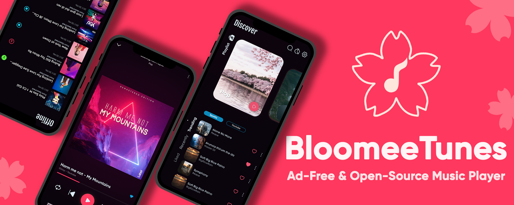
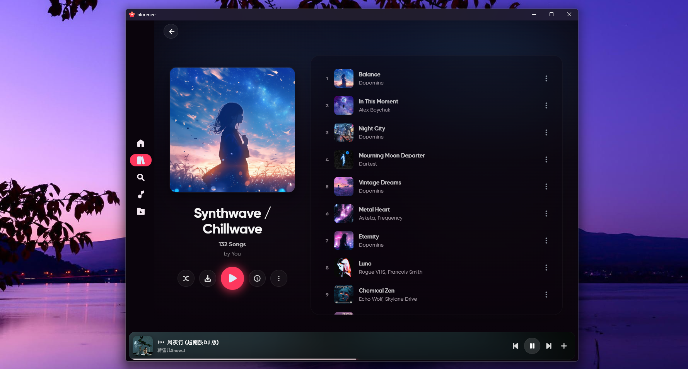
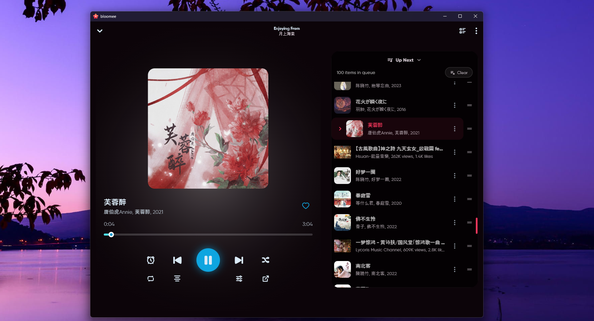
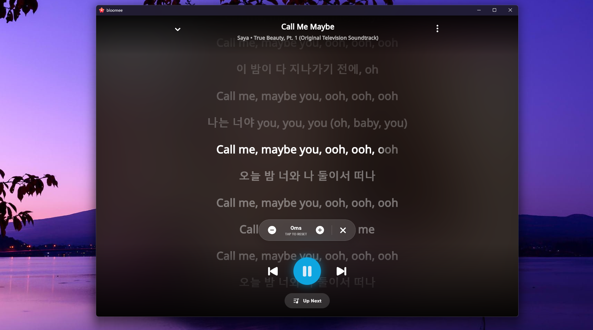

<div align="center">



# Orvia

**A unified local and plugin-first streaming music player built with Flutter and Rust.**

<p align="center">
  <a href="https://github.com/Ankitcodes30/Orvia/releases/latest"></a>
  <a href="https://github.com/Ankitcodes30/Orvia/releases/latest"></a>
  <a href="./LICENSE"></a>
  <a href="https://github.com/Ankitcodes30/Orvia/actions/workflows/checkout.yml"></a>
</p>

<p align="center">
  
  
  
</p>

Orvia is an experimental, open-source music player for your local files and for
plugin-backed remote music. Most remote sources are sandboxed, Rust-backed
WebAssembly plugins; the app also includes a small curated JioSaavn discovery
layer. No ads and no forced account.

</div>

<div align="center">
  <p float="left">
    
    
  </p>
  <p float="left">
    
    
    
  </p>
</div>

---

> **Security warning: use official sources only.**
>
> The official Orvia pages maintained by the project are:
>
> - <https://github.com/Ankitcodes30/Orvia>
> - <https://ankitcodes30.github.io/Orvia/>
>
> Unofficial sites may distribute modified APKs or malware. Download from the
> official GitHub Releases link below. The project is not responsible for damage
> caused by third-party builds.

---

## What is Orvia?

Orvia gives you one library and one player for two kinds of music:

- **Your local music** — device files, downloaded tracks, and your own library.
- **Remote music** — search, charts, home sections, and streams supplied by
  installable plugins.

The app is built with Flutter for the UI, BLoC for state, Isar for local storage,
and Rust for the plugin runtime, download manager, and local-music helpers.
Plugins are WebAssembly components packaged as `.bex` files. A few curated
discovery surfaces (Best of 2026, Creator's Choice, festival/Navratri cards,
featured artists) contain built-in JioSaavn references and require the JioSaavn
content-resolver plugin for playback.

## Feature highlights

| Feature | Status | Summary |
|---|---|---|
| Local + remote playback | Shipped | Play local files and plugin-backed streams in the same queue. |
| Plugin-first sources | Shipped | Content resolvers, charts, lyrics, suggestions, and importers are plugins. |
| Curated discovery | Shipped | Built-in JioSaavn lists and festival cards; playback requires the JioSaavn content-resolver plugin. |
| Synced lyrics | Shipped | Karaoke-style lyrics with manual offset and full-screen view. |
| Equalizer and crossfade | Shipped | 10-band EQ with device passthrough mode; configurable crossfade. |
| Smart Replace | Shipped | Finds working replacements when a remote track goes dead. |
| Downloads and offline | Shipped | Rust-backed download manager with pause, resume, and cancel. |
| Library and backup | Shipped | Playlists, likes, history, import/export, and backup/restore. |
| Integrations | Platform-dependent | Last.fm scrobbling; Discord Rich Presence on Windows, Linux, and macOS. |
| Localization | Shipped | English, Hindi, German, Spanish, Japanese, Korean, and Chinese ARB files. |

See the full [feature catalog](docs/product/features.md) for implementation
details and status.

## Platform support

| Platform | Status |
|---|---|
| Android | Supported release target |
| Windows | Supported release target |
| Linux | Supported release target |
| iOS | Platform folder exists; experimental, not a release target |
| macOS | Platform folder exists; experimental, not a release target |
| Web | Platform folder exists; experimental, not a release target |

The release workflow currently produces Android, Windows, and Linux artifacts.

## Download and install

<p align="center">
  <a href="https://github.com/Ankitcodes30/Orvia/releases/latest">
    
  </a>
</p>

GitHub Releases is the current official download channel. The SourceForge and
IzzyOnDroid listings previously referenced by this project are not currently
reachable and should not be used until they are re-verified.

For first-run setup, plugins, local music, downloads, lyrics, and troubleshooting,
read the [user guide](docs/product/user-guide.md).

## Documentation

| Document | Description |
|---|---|
| [Product overview](docs/product/overview.md) | What Orvia is, who it is for, and how it fits together. |
| [Feature catalog](docs/product/features.md) | What works today, with status and code locations. |
| [User guide](docs/product/user-guide.md) | Install, first run, plugins, local music, playback, backup. |
| [FAQ](docs/product/faq.md) | Common questions about sources, plugins, data, and platforms. |
| [Architecture](ARCHITECTURE.md) | Layer model, boundaries, data layer, state, services, navigation. |
| [Getting started](docs/development/getting-started.md) | Set up Flutter and Rust, then run the app. |
| [Build and run](docs/development/build-and-run.md) | Platform builds and release artifacts. |
| [Testing](docs/development/testing.md) | Analyze, test, and CI commands. |
| [Plugin overview](docs/plugins/overview.md) | Plugin runtime, lifecycle, events, cache, and security model. |
| [Plugin authoring](docs/plugins/authoring.md) | Plugin types, WIT interfaces, commands, and host capabilities. |
| [Manifest and packaging](docs/plugins/manifest-and-packaging.md) | `manifest.json`, `.bex` layout, and repository manifests. |
| [Release process](docs/operations/release.md) | CI, signing, fastlane, and website deployment. |
| [Contributing](CONTRIBUTING.md) | Contribution workflow, checks, and review expectations. |
| [Roadmap](docs/product/roadmap.md) | Current focus areas and how work is planned. |

## Quick start for contributors

Requirements: Flutter `3.35.4` stable, Dart SDK `>=3.3.0`, Rust stable, and the
platform toolchain for your target.

```bash
git clone https://github.com/Ankitcodes30/Orvia.git
cd Orvia
flutter pub get
flutter analyze --no-fatal-infos
cargo check --manifest-path rust/Cargo.toml
flutter run -d windows   # or: linux, or an Android device
```

If you change the Rust API, regenerate the bridge bindings using the
`flutter_rust_bridge.yaml` configuration before running the app.

Start with [docs/development/getting-started.md](docs/development/getting-started.md)
for prerequisites, platform notes, and common setup errors.

## Plugin development

Orvia plugins are WebAssembly components packaged as `.bex` files. The runtime
supports five plugin types:

- `content-resolver`
- `chart-provider`
- `lyrics-provider`
- `search-suggestion-provider`
- `content-importer`

Read [Plugin overview](docs/plugins/overview.md) first, then
[Authoring](docs/plugins/authoring.md) and
[Manifest and packaging](docs/plugins/manifest-and-packaging.md).

## Project status

Orvia is experimental. The `3.x` line moved most of the app to a plugin-first
architecture, with the curated JioSaavn layer as a legacy exception, and the
plugin API may still change. See the
[CHANGELOG](CHANGELOG.md) for release history and the [roadmap](docs/product/roadmap.md)
for direction.

## Contributing

Every contribution counts. Open an issue before starting a large change, branch
from `main`, run the documented checks, and submit a focused pull request.

- [CONTRIBUTING.md](CONTRIBUTING.md)
- [CODE_OF_CONDUCT.md](CODE_OF_CONDUCT.md)
- [Good first contributions](docs/product/roadmap.md#good-first-contributions)

## Security

Do not open public issues for vulnerabilities. Follow [SECURITY.md](SECURITY.md)
to report them privately.

## License and attribution

Orvia is licensed under the **GNU General Public License v2.0 (GPL-2.0)**. See
[LICENSE](LICENSE).

Orvia is created and maintained by **Ankit Kumbhare**. It builds on the
open-source foundation originally created by **Hemant Karya**.

## Get in touch

<div align="center">

<a href="https://www.linkedin.com/in/ankit-kumbhare-024465366/"></a>
<a href="https://github.com/Ankitcodes30"></a>
<a href="mailto:ankitkumbhare301@gmail.com"></a>

</div>
